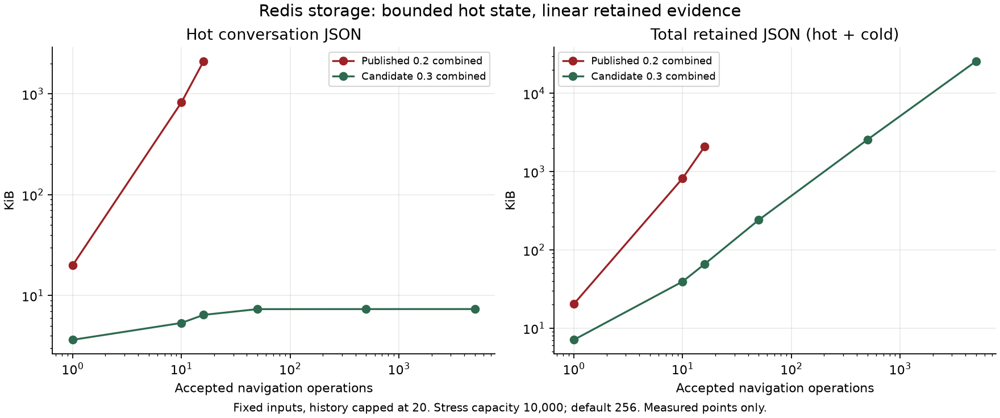
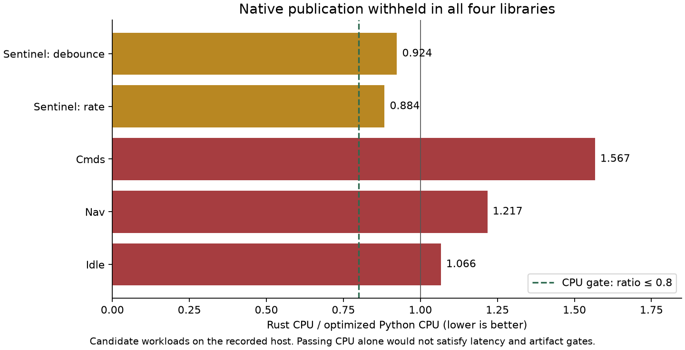

# Four-library optimization delivery

All four Python base releases are published on PyPI with GitHub releases. Exact
wheel/sdist hashes and fresh index-only installs were verified. Nav preceded Idle;
the published optional integration resolves and an atomic memory adoption probe
passes with native companions absent. No application deployment or live Redis
migration was performed.

| Library | Released | Implementation |
| --- | --- | --- |
| [Sentinel](https://github.com/ArmanAvanesyan/aiogram-sentinel/releases/tag/v1.3.0) | 1.3.0 | Middleware/key/counter allocation improvements; optional native limiter/debounce source |
| [Cmds](https://github.com/ArmanAvanesyan/aiogram-cmds/releases/tag/v0.3.0) | 0.3.0 | Immutable explicit compiled profiles/batches, revision invalidation and delivery-boundary SDK models |
| [Nav](https://github.com/ArmanAvanesyan/aiogram-nav/releases/tag/v0.3.0) | 0.3.0 | Canonical receipts, bounded Redis hot state, atomic tracking and ownership/migration proofs |
| [Idle](https://github.com/ArmanAvanesyan/aiogram-idle/releases/tag/v0.3.0) | 0.3.0 | Single-receipt activation, standalone/optional canonical integration, recovery and bounded storage |

The earlier Idle0.2.1 correctness patch was also published before the format-three
work. Python remains default; aiogram, async I/O, application callbacks, FSM and
session authority remain in Python. Each independent native project uses
PyO3/Maturin, ABI1 and the exact matching base version. Their source is implemented
and functionally tested, but **no native companion, native tag or unavailable extra
was published** because none passed the agreed performance gate.

## Storage results

The old combined layout copied an expanding navigation ledger into repeated Idle
receipts. Format three uses one canonical operation ledger and keeps terminal
receipts separate from current state. At5000 transitions, standalone Idle hot
JSON is1597B, standalone Nav3537B and combined7524B. Cold evidence grows linearly;
combined stores5000 receipts and26.4MB total JSON rather than repeatedly embedding
all prior receipts inside new ones. History stays capped at20.

At16 combined transitions, measured client calls fell1120→272 and computed RESP
request bytes93,375,695→1,054,633. These are fixture-specific client/request
measurements, not Lua-internal command counts or total TCP traffic. Warm protected
Dispatcher probes use3 unchanged/8 tracked calls for Nav and4 unchanged/17 tracked
for the combined integration, within the agreed≤5/≤20 budgets. Application FSM,
authority I/O, rendering, bootstrap and contention are itemized separately.

The5000-operation fixtures explicitly use10000 receipt slots. Default256-slot
profiles still reject action257 while promises remain live. Size capacity as peak
accepted operations/sec × replay seconds, plus protected-evidence headroom. Expired
terminal evidence is reclaimable; unexpired promised results and unresolved effects
are protected. Arbitrary IDs do not provide permanent deduplication after evidence
expires. Combined memory retains higher constant cost and copies bounded metadata;
no universal constant CPU cost or production millisecond SLO is promised.

Growth timings under concurrent tests remain exploratory. The source/operation
counts and retained-byte slopes support the storage conclusions independently of
host scheduling. Full raw data and inspection boundaries are retained in
[the Nav growth report](../optimization/state-growth/candidate-nav-030/README.md)
and [the Idle/combined growth report](../optimization/state-growth/candidate-idle-030/README.md).

## Rust gate results

Native publication required at least20% representative CPU improvement and no
reproducible greater-than5% end-to-end p95 regression. Measured Rust/Python CPU:
Sentinel rate0.884/debounce0.924, Cmds1.567, Nav1.217, Idle1.066. Sentinel gains
were below the threshold; the other selected workloads were slower. Some tails
were noisy, and published baseline drift prevents reliable blanket Python speedup
percentages for Sentinel/Cmds. No positive native qualification is claimed.

Reports preserve frozen installed artifacts, hardware, workload boundaries, seeds,
raw arrays and serial ordering. Later hardening adds isolated execution, unique
run identities, strict finite/count validation and matching base/native/peer/driver
provenance. Historical failed gates cannot qualify through the stricter evaluator.
Idle's final validation-only changes are itemized in its artifact-delta.json;
negative native decisions are retained conservatively.

- [Sentinel](sentinel-serial/REPORT.md)
- [Cmds](cmds-serial/REPORT.md)
- [Nav](nav-serial/REPORT.md)
- [Idle](idle-serial/REPORT.md)

## Verification and rollout

Independent audits fixed same-stage duplicate sends, lease/claim handling,
authority revocation after callbacks, session-scoped view ownership, missing-index
witnesses, Lua preflight ordering, expired owner proofs and migration atomicity.
Memory/Redis parity, original results and finite replay promises remain intact.
Full source coverage exceeds80%; real Redis7/8, regular CPython3.10–3.14,
minimum/latest supported aiogram, standalone installs, all four mixed engine
profiles and actual downloaded native platform wheels passed CI. Functional
platform compatibility is separate from performance qualification.

Existing Redis layouts require backup, draining old writers, read-only assessment
and explicit activation/migration. Installing0.3 alone does not migrate data.
Fresh namespaces can explicitly select storage_format=3. Idle progresses1→2→3;
Nav supports explicit1/2→3 conversion. Preserve unresolved evidence and follow the
immutable source-backup cleanup proof requirements.

Read [Nav migration/engine guidance](https://github.com/ArmanAvanesyan/aiogram-nav/blob/main/docs/performance-and-engines.md)
and [Idle migration guidance](https://github.com/ArmanAvanesyan/aiogram-idle/blob/main/docs/migration-0.3.md).
Memory remains single-process/non-durable. Redis durability is deployment-owned;
no global exactly-once external effects, durable analytics outbox, native
free-threaded Python or WindowsARM64 support is promised.

The benchmark/verifier tools have101 passing tests, Ruff/actionlint checks and
CPython3.10/3.12/3.14 CI. Charts are reproducible via tools/optimization/render_summary.py;
PNG/SVG/data hashes are included. Temporary owned Redis containers were removed.
Pre-existing uncommitted Kit designs and mkdocs changes remain untouched.
